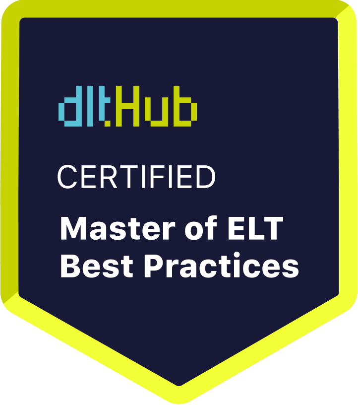

# Certificate of Achievement: Master of ELT Best Practices

## Awarded to **Rajagopal Parthasarathi**

### Certificate Details
- **Certificate ID**: `036cb760b377235622df4d55cf9af1c5f8abd44cc688050592ce6022d0861900`
- **Certificate Holder ID**: `b58439fdd8dfe901d2605dbb60ba6421db61807181fb3ef9b98e2db406c7a0f9`

### Course Information
- **Course**: [Data Engineering with Python and AI/LLMs](https://www.youtube.com/watch?v=T23Bs75F7ZQ)

### Issued by
[**dltHub**](https://dlthub.com/) 

### Certification Period
- **Issued**: August 2025
- **Valid Until**: No expiration

---

## Contact Information
- **GitHub**: rparthas
- **Contact**: https://www.linkedin.com/in/rajagopalparthasarathi/

## Comments
Rajagopal Parthasarathi has successfully completed the Data Engineering with Python and AI/LLMs. We commend their dedication and expertise in the field.

---

For more information, please visit [dltHub](https://dlthub.com/).
    